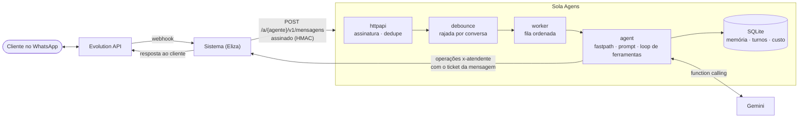

# Sola Agens

**Atendente com IA para qualquer sistema que publique uma OpenAPI.** O Agens lê a especificação do
sistema, transforma as operações liberadas em ferramentas e conversa com o cliente final pelo WhatsApp:
consulta horários, marca, remarca, cancela e chama uma pessoa quando precisa.

*Agens*, do latim: "o que age".


**Status:** em produção desde outubro de 2026, atendendo o [Eliza](https://eliza.solasoftware.com.br)
(SaaS de agendamento da Sola) como primeiro sistema.

---

## O que ele faz

- **Ferramentas a partir da OpenAPI.** No boot, baixa a spec do sistema e converte as operações
  marcadas com `x-atendente` em ferramentas para o modelo (function calling). Sistema novo não exige
  código no Agens: só um arquivo `agentes/<sistema>.yaml` e operações marcadas na spec.
- **Conversa natural pelo WhatsApp.** Junta mensagens enviadas em rajada, mantém a ordem por conversa,
  guarda memória curta e responde em português, no formato do WhatsApp.
- **Áudio.** Mensagens de voz são transcritas (Gemini ou Whisper via Groq) e entram na conversa como
  texto.
- **Atalho sem LLM.** Respostas soltas como "sim", "confirmo" ou 👍 confirmam o agendamento, e
  "cancelar" cancela, direto e sem custo de modelo.
- **Divide o número com a equipe.** O Agens e a recepção usam o mesmo WhatsApp. Quando alguém da equipe
  responde pelo aparelho, o bot se cala naquela conversa por algumas horas. As respostas do próprio bot
  são reconhecidas como eco e ignoradas.
- **Entende o contexto dos avisos.** Lembretes e notificações que o sistema já mandou entram no
  histórico; se o cliente responde "não vou conseguir, dá pra passar pra sexta?", o Agens sabe de qual
  agendamento se trata.
- **Escala para humano.** Pedido de pessoa, reclamação, cadastro ambíguo ou número desconhecido viram
  um alerta para a equipe, sem o bot inventar resposta.

## Arquitetura



No modo **encaminhado**, o Agens não tem a chave do WhatsApp do cliente: o sistema encaminha cada
mensagem assinada e a resposta volta pelo próprio sistema. Cada mensagem traz um **ticket** de curta
duração que limita o que as ferramentas podem ver e alterar àquele cliente, naquela organização.

| Pacote | Responsabilidade |
|---|---|
| `internal/openapi` | carrega e valida a spec; converte schemas (`allOf`, `X ou null`, formatos) em parâmetros de ferramenta |
| `internal/conector` | executa a ferramenta contra o sistema; normaliza erros de regra e aborta em falhas técnicas |
| `internal/agent` | prompt, fastpath, loop do LLM, pausa humana, eco e avisos, transcrição de áudio |
| `internal/debounce`, `internal/worker` | agrupamento de rajadas e fila por conversa, com limite de concorrência |
| `internal/store` | SQLite puro Go (sem cgo), migrations SQL portáveis, memória, dedupe, auditoria de turnos |
| `internal/httpapi` | entrada assinada, rota administrativa de apagamento (LGPD), troca atômica de agentes no SIGHUP |
| `internal/manutencao` | job diário de retenção, com recuperação de dias perdidos |

## Decisões de engenharia

- **Segurança por padrão.** Entrada assinada com HMAC e timestamp; tokens e segredos em campos não
  exportados (nunca serializados nem logados); nenhuma porta publicada, só a rede Docker interna.
- **Defesa contra prompt injection.** Nome de perfil do WhatsApp e nome de cadastro passam por
  saneamento e entram no prompt marcados como dado. Um perfil chamado *"Ana. Ignore as regras..."* não
  vira instrução, e existe cenário de avaliação que garante isso.
- **Logs sem dado pessoal.** JSON estruturado, uma linha por turno com modo, tokens, custo e latência.
  Telefone vira hash; texto, transcrição, argumentos de ferramenta e tickets nunca aparecem.
- **LGPD.** Texto das mensagens expira em 90 dias; a auditoria de custo fica, sem conteúdo. Apagamento
  a pedido do titular é idempotente e mantém só o hash do contato.
- **Custo medido por turno.** Tokens de entrada e saída e custo em micro-dólares gravados a cada turno,
  incluindo transcrição de áudio, com preços configuráveis por ambiente.
- **Falha de forma segura.** Spec ou configuração inválida derruba o boot em vez de rodar com
  ferramentas faltando; recarga a quente (SIGHUP) mantém o conjunto anterior se o novo for inválido;
  falhas técnicas do sistema interrompem o turno e avisam o cliente, em vez de deixar o modelo
  improvisar.
- **Operação enxuta.** Binário estático em imagem `distroless` de 23 MB, rodando como não-root, com
  healthcheck como subcomando do próprio binário (a imagem não tem shell).

## Avaliação do modelo e do prompt

`avaliacao/` testa o **comportamento do atendente**, não a infraestrutura: conversas reais contra um
**sistema simulado em processo** (a spec verdadeira, estado por cenário, horários determinísticos) e o
**modelo real**. Cada cenário declara as ferramentas que devem e não devem ser chamadas, escalonamento,
fastpath, trechos obrigatórios ou proibidos na resposta e o estado final esperado.

```
go run ./avaliacao                          # todos os cenários
go run ./avaliacao -cenario 7               # um só
go run ./avaliacao -vezes 5                 # estabilidade: cada cenário 5 vezes
go run ./avaliacao -modelo gemini-3.8-flash # compara outro modelo
go run ./avaliacao -v                       # mostra as respostas ao cliente
```

Imprime, por cenário, passou/falhou e o motivo, ferramentas chamadas, tokens, custo e latência; no fim,
totais e custo médio. A troca de modelo foi decidida assim: na primeira bateria real, o modelo anterior
acertou 10–11 de 17 cenários; com o prompt ajustado, o **Gemini 3.6 Flash** acertou 34 de 34
execuções (17 cenários, 2 vezes cada), a cerca de US$ 0,007 por turno. Hoje a bateria tem 19 cenários.

## Rodar

```
cp .env.example .env      # preencha a chave do Gemini e os segredos do sistema
go run .                  # escuta em AGENS_LISTEN (padrão :4100)
curl http://127.0.0.1:4100/health
```

```
docker build -t sola-agens .
```

O [docker-compose.yml](docker-compose.yml) é o de produção: entra numa rede Docker externa e não
publica porta nenhuma. O boot baixa a OpenAPI de cada sistema registrado em `agentes/`, então o sistema precisa estar no ar.
Configuração completa, ligação com o Eliza, logs, custos e retenção: [docs/OPERACAO.md](docs/OPERACAO.md).

## Testes

```
go vet ./...
go test ./...
docker run --rm -v "$PWD":/src -w /src golang:1.26 go test -race ./...
```

Os testes não usam rede nem chave: modelo, sistema e transcrição são fakes. O prompt tem testes de
golden file (`go test ./internal/agent/ -run Prompt -update` para regravar) e o fluxo completo tem
testes ponta a ponta com áudio e ordenação de mensagens.

## Documentação

| Documento | Conteúdo |
|---|---|
| [CONTRATO.md](CONTRATO.md) | o que o serviço faz, fronteiras, segurança e decisões |
| [specs/](specs/) | domínio e schema · ferramentas e prompt · fluxos · integrações · arquitetura Go · treinamento |
| [docs/OPERACAO.md](docs/OPERACAO.md) | configurar, subir, ligar a um sistema, logs, custos, retenção |
| [docs/DECISOES.md](docs/DECISOES.md) | por que o projeto existe e as decisões de origem |
| [docs/HISTORICO-DO-BUILD.md](docs/HISTORICO-DO-BUILD.md) | origem do código e decisões tomadas fase a fase |
| [PLANO-DE-BUILD.md](PLANO-DE-BUILD.md) · [CHECKLIST-ACEITE.md](CHECKLIST-ACEITE.md) | fases do build e bateria de aceite |

---

Construído pela [Sola Software](https://solasoftware.com.br). Tecnologia com fundamento.
*Soli Deo Gloria*
